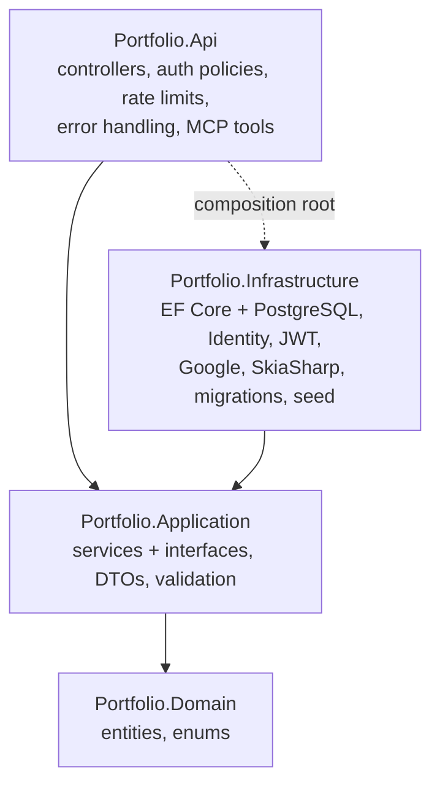

# Ashikur Rahman — Portfolio API (Backend)

The backend of my developer portfolio: an **ASP.NET Core (.NET 10) Web API** with a layered
(clean architecture) design, PostgreSQL through EF Core, Google sign-in with JWT and rotating refresh
tokens, an admin API, image compression, and an **MCP server** that lets AI agents draft blog posts.

The website that uses it: **[Portfolio-Web](https://github.com/AshikurWebDev/Portfolio-Web)** (React 19 + TypeScript).

## Contents

- [Highlights](#highlights)
- [Tech stack](#tech-stack)
- [Architecture](#architecture)
- [Getting started](#getting-started)
- [API overview](#api-overview)
- [Authentication](#authentication)
- [Security](#security)
- [Feature notes](#feature-notes): design gallery, skills, CV, MCP server
- [Database](#database)
- [Configuration](#configuration)
- [Deployment](#deployment)

## Highlights

- **Clean architecture in four projects**: Domain, Application, Infrastructure, Api. Dependencies point
  inward; business rules never touch EF Core or HTTP directly.
- **Controllers, DTOs and service interfaces everywhere**: entities never leave the API; every
  service has an interface; one class per file.
- **Secure by default**: Google ID token verification plus an email allowlist, 15-minute JWTs, hashed
  and rotated refresh tokens, Argon2id passwords, rate limits, RFC 7807 errors.
- **Real-time updates**: a SignalR hub tells every open copy of the website when content changes;
  services depend only on an `ISiteEvents` interface.
- **Real-world features**: WebP compression with SkiaSharp, PDF validation, ETag caching, cascading
  deletes, ordered collections, and an MCP server built on the official C# SDK.
- **Production-ready**: Dockerfile (non-root), Docker Compose with Caddy and automatic HTTPS, forwarded
  headers, migrations and seeding on start-up.
- **Documented for readers**: XML doc comments on every public member (they feed the OpenAPI document),
  comments that explain *why*, and a `.http` file with a request for every endpoint.

## Tech stack

| Area | Technology |
|------|------------|
| Runtime | .NET 10, ASP.NET Core Web API (controllers) |
| Data | EF Core 10 (code first, migrations), PostgreSQL 18 (Npgsql) |
| Identity | ASP.NET Core Identity (users, roles, external logins), Argon2id hasher |
| Tokens | JWT (HMAC-SHA256) access tokens, rotating refresh tokens, personal access tokens for agents |
| Sign-in | Google Identity Services (`Google.Apis.Auth` token validation) |
| Images | SkiaSharp (WebP encoding, EXIF orientation) |
| Real-time | ASP.NET Core SignalR (live content updates to open pages) |
| AI | `ModelContextProtocol.AspNetCore` (MCP over Streamable HTTP) |
| Docs | OpenAPI (`Microsoft.AspNetCore.OpenApi`) + Scalar reference UI |
| Ops | Docker, Docker Compose, Caddy |

## Architecture



```
src/
├── Portfolio.Domain/          Plain C# entities and enums. No framework code.
│   ├── Entities/              Post, Project (+ facts, highlights, media), ContactMessage, DesignPost,
│   │                          SkillGroup, Skill, CvDocument, RefreshToken, ApiToken
│   ├── Enums/                 SystemLayer, PostStatus, ProjectStatus
│   └── Common/                AuditableEntity (CreatedAt / UpdatedAt, set automatically)
│
├── Portfolio.Application/     Use cases: WHAT to do, not HOW it is stored.
│   ├── Common/                IAppDbContext, ICurrentUser, IImageCompressor, exceptions
│   ├── Posts/ Projects/ Contact/ Design/ Skills/ Cv/ Overview/
│   │                          one folder per feature: I…Service + …Service + Dtos/
│   ├── Auth/ ApiTokens/       interfaces + DTOs (implemented in Infrastructure)
│   └── DependencyInjection.cs
│
├── Portfolio.Infrastructure/  HOW: PostgreSQL, Identity, tokens, Google, images.
│   ├── Persistence/           AppDbContext, Configurations/ (one per entity), Migrations/, Seed/
│   ├── Identity/              AppUser, Roles, Argon2idPasswordHasher
│   ├── Auth/                  AuthService, JwtTokenService, GoogleTokenValidator, ApiTokenService,
│   │                          ApiTokenAuthenticationHandler, TokenHasher
│   ├── Images/                SkiaWebpCompressor
│   ├── Options/               Strongly typed settings (validated on start-up)
│   └── SeedData/              Starter projects and draft posts
│
└── Portfolio.Api/             HTTP layer.
    ├── Controllers/           Public: Posts, Projects, Skills, Cv, DesignPosts, Contact, Auth, Figures
    ├── Controllers/Admin/     Overview, Posts, Skills, Cv, DesignPosts, Messages, ApiTokens
    ├── Forms/                 Multipart upload models
    ├── Mcp/                   BlogTools, BlogPrompts, WritingGuide
    ├── Realtime/              SiteHub (SignalR), SignalRSiteEvents (implements ISiteEvents)
    ├── Middleware/            ApiExceptionHandler (exceptions → problem details)
    ├── Extensions/            AuthenticationSetup, RateLimitSetup
    └── Program.cs
deploy/                        Production Docker Compose + VPS guide
Dockerfile                     API image
docker-compose.yml             PostgreSQL for development
```

### How a request flows

Example: `PUT /api/admin/skills/{id}`

1. **Controller** (`AdminSkillsController.UpdateSkill`) receives a `SaveSkillRequest` DTO.
   `[ApiController]` validates its data annotations (`[Range(0, 100)]`, `[MaxLength]`) and returns 400
   automatically when they fail. `[Authorize(Policy = "Admin")]` has already checked the token.
2. It calls **`ISkillService.UpdateSkillAsync`**. The service applies rules annotations cannot express
   (the logo key must be known, the target card must exist) and uses **`IAppDbContext`**.
3. **`AppDbContext`** stamps `UpdatedAt` and saves through EF Core, which sends parameterized SQL.
4. The service maps the entity to a **`SkillResponse`** DTO.
5. Any `NotFoundException` or `RequestValidationException` is turned into an RFC 7807 problem details
   response (404 / 400) by **`ApiExceptionHandler`**.

## Getting started

Requirements: .NET SDK 10, Docker Desktop.

```bash
git clone https://github.com/AshikurWebDev/Portfolio-API.git
cd Portfolio-API

docker compose up -d                 # PostgreSQL 18 on localhost:55432
dotnet tool restore                  # dotnet-ef (local tool)

cd src/Portfolio.Api
dotnet user-secrets set "Jwt:SigningKey" "<at least 32 random characters>"
dotnet user-secrets set "Admin:AllowedEmails:0" "<your Gmail address>"
dotnet user-secrets set "Authentication:Google:ClientId" "<client id>.apps.googleusercontent.com"
# Optional password sign-in for local work without Google:
dotnet user-secrets set "Seed:AdminEmail" "<email>"
dotnet user-secrets set "Seed:AdminPassword" "<12+ characters>"

dotnet run --launch-profile http     # http://localhost:5180
```

In Development the API applies migrations and seeds the Admin role, the optional admin account, two
projects, three **draft** posts and the starting Skills section. Each step runs only when its data is
missing, so restarts never duplicate anything.

| URL | What |
|-----|------|
| http://localhost:5180/scalar | Interactive API reference (Development only) |
| http://localhost:5180/openapi/v1.json | OpenAPI document |
| http://localhost:5180/health | Health check |
| `src/Portfolio.Api/Portfolio.Api.http` | A ready request for every endpoint (VS Code REST Client, Visual Studio, Rider) |

To run the website against it, see [Portfolio-Web](https://github.com/AshikurWebDev/Portfolio-Web).

## API overview

### Public

| Method | Path | Description |
|--------|------|-------------|
| GET | `/api/projects` | Portfolio projects with facts, highlights and media |
| GET | `/api/posts` | Published blog posts (no body) |
| GET | `/api/posts/{slug}` | One published post with its Markdown body |
| GET | `/api/skills` | Skill cards with their skills (name, level 0-100, logo key, note) |
| GET | `/api/cv` | The CV PDF, downloaded as `Ashikur-Rahman-CV.pdf` (404 when none) |
| GET | `/api/cv/info` | `{ available, url, uploadedAt }` (always 200) |
| GET | `/api/design-posts` | Visible design gallery items |
| GET | `/api/design-posts/{id}/image` | One gallery image (WebP, cached for a year) |
| GET | `/api/figures` | Figure ids that blog posts may embed |
| POST | `/api/contact` | Contact form; returns 202 (429 when rate limited) |
| WS | `/hubs/site` | SignalR hub: the server sends `contentChanged(topic)`; clients cannot call anything |

### Authentication

| Method | Path | Description |
|--------|------|-------------|
| POST | `/api/auth/google` | Exchange a Google ID token for an access token + refresh cookie |
| POST | `/api/auth/login` | Email + password (seeded admin, development) |
| POST | `/api/auth/refresh` | New access token from the refresh cookie (rotates it) |
| POST | `/api/auth/logout` | Revoke the refresh token and clear the cookie |
| GET | `/api/auth/me` | The signed-in user |

### Admin (`Admin` policy)

| Area | Endpoints |
|------|-----------|
| Overview | `GET /api/admin/overview` |
| Posts | `GET/POST /api/admin/posts`, `GET/PUT/DELETE /api/admin/posts/{id}`, `POST …/{id}/publish`, `POST …/{id}/unpublish` |
| Skills | `GET /api/admin/skills`; cards: `POST /groups`, `PUT/DELETE /groups/{id}`, `PUT /groups/order`; skills: `POST /groups/{groupId}/skills`, `PUT/DELETE /{id}`, `PUT /groups/{groupId}/skills/order` |
| CV | `GET/PUT/DELETE /api/admin/cv` |
| Design gallery | `GET/POST /api/admin/design-posts`, `GET/PUT/DELETE …/{id}`, `PUT …/{id}/image`, `PUT …/order` |
| Messages | `GET /api/admin/messages`, mark as read |
| Agent tokens | `GET/POST /api/admin/api-tokens`, revoke |
| MCP | `POST /mcp` (admin JWT or personal access token) |

The OpenAPI document lists every endpoint with its request and response types.

## Authentication

| Who | How | Token |
|-----|-----|-------|
| The site owner, in the admin dashboard | Google sign-in (email + password only in local development) | JWT access token (15 min, kept in memory by the website) + refresh token in an HttpOnly cookie |
| An AI agent on `/mcp` | Personal access token created in the dashboard | `Authorization: Bearer pat_…` |

- **Google sign-in:** the browser gets an ID token from Google and posts it to `/api/auth/google`.
  `GoogleTokenValidator` checks Google's signature, expiry and audience (this site's client id).
  The email must then be on `Admin:AllowedEmails`; anyone else gets 403. There is no sign-up endpoint.
- **Identity:** ASP.NET Core Identity stores users, roles and Google logins (`AddIdentityCore`, no cookies, no UI).
- **Argon2id:** replaces Identity's default PBKDF2 hasher (OWASP parameters: 19 MiB, 2 iterations).
  Five wrong passwords lock the account for 15 minutes.
- **JWT:** HMAC-SHA256, 15-minute lifetime, 30-second clock skew. Refresh tokens are 48 random bytes,
  stored only as SHA-256 hashes, rotated on every use and revoked on sign-out.
- **Two token types, one header:** a policy scheme sends `Bearer pat_…` to `ApiTokenAuthenticationHandler`
  and everything else to JWT bearer.

## Security

Checked on 2026-11-16 against the running API and the production Docker stack.

| Concern | How it is handled | Checked |
|---------|-------------------|---------|
| SQL injection | All queries are EF Core LINQ, sent as parameterized SQL. No raw SQL (`FromSqlRaw`, `ExecuteSqlRaw`) exists in the code. | Code search; a `' OR 1=1--` probe returns 404 |
| CORS | Only origins in `Cors:AllowedOrigins` are allowed (with credentials). In production the site and API share one origin behind Caddy, so the list stays empty. | A foreign `Origin` receives no `Access-Control-Allow-Origin` header |
| CSRF | Admin endpoints authenticate with the `Authorization` header, which browsers never attach automatically. The refresh cookie is `HttpOnly`, `Secure` (outside Development), `SameSite=Strict` and scoped to `/api/auth`. | Code review; unauthenticated admin writes return 401 |
| Authorization | Every admin controller carries `[Authorize(Policy = "Admin")]`; MCP requires the same policy. | 401 without a token |
| Brute force and spam | Fixed-window rate limits per client IP on `/api/auth/*` and `/api/contact`; account lockout after 5 failed passwords. | Code review |
| Input validation | Data annotations on every DTO, plus service-level rules; errors return as RFC 7807 validation problems. | Requests with bad input return 400 |
| File uploads | Per-endpoint size limits (15 MB images, 5 MB CV). Images are decoded and re-encoded (EXIF/GPS dropped, over 50 megapixels refused). A CV must start with `%PDF-`; names and content types from the browser are not trusted. | Upload tests |
| Stored markup | Skill logos are stored as keys from a fixed allowlist (`SkillIcons.cs`), never as SVG or HTML. | Code review |
| Secrets | Nothing secret in the repository: user-secrets in development, environment variables in production. Options are validated on start-up (`ValidateOnStart`), so a missing JWT key stops the app. | Repository scan |
| Transport | Behind Caddy: HTTPS only, `nosniff`, `X-Frame-Options: DENY`, strict referrer policy. Forwarded headers give the API the real scheme and client IP. The API container is not published on the host. | Response headers checked |

Not yet exercised: the per-IP rate limit under real traffic behind the production proxy.

## Feature notes

### Design gallery

Images uploaded in the dashboard are stored in PostgreSQL as compressed WebP.

1. `AdminDesignPostsController` accepts JPEG, PNG, WebP or GIF up to 15 MB.
2. `DesignPostService` passes the stream to **`IImageCompressor`**. The Application layer only knows the
   interface; `SkiaWebpCompressor` in Infrastructure implements it with **SkiaSharp**.
3. The compressor applies the EXIF orientation, caps the long side at 1600 px, then lowers WebP quality
   (82 down to 45) and, if needed, scales both sides by the same factor until the file is
   **100 KB or less**. The aspect ratio never changes.
4. Bytes are saved in a `bytea` column with a content hash. List queries project to DTOs, so image bytes
   are only read by the image endpoint.

Image URLs include the hash (`?v=…`), so images are served with `Cache-Control: immutable` for a year
plus an ETag; a replaced image gets a new URL.

### Skills

- Cards (`SkillGroup`) hold skills (`Skill`: name, level 0-100, logo key, note). Deleting a card cascades
  to its skills (database `ON DELETE CASCADE`); a check constraint keeps levels between 0 and 100.
- Order is stored as `SortOrder`; reorder endpoints take the full id list and reject missing or
  duplicate ids.
- Logos are keys such as `react` or `postgresql`, checked against `Application/Skills/SkillIcons.cs`.
  The website maps each key to an SVG.
- `Infrastructure/Persistence/Seed/SkillSeed.cs` adds the starting cards when the table is empty.

### CV

- One `CvDocument` row; uploading replaces it. The upload is read with a 5 MB cap and must start with `%PDF-`.
- `GET /api/cv` keeps a stable URL, so it is cached for 5 minutes and revalidated with an ETag instead of
  being cached for a year. `GET /api/cv/info` always answers 200, so a missing CV is not logged as an error.

### Live updates (SignalR)

- Services call `ISiteEvents.ContentChangedAsync(topic)` after a change is saved (design, skills, CV,
  and published posts). The interface lives in the Application layer; `SignalRSiteEvents` in the Api
  project implements it with `IHubContext<SiteHub>`.
- The hub at `/hubs/site` is server-to-client only. Messages carry just the topic name, never content,
  so nothing private is broadcast. A failed broadcast is logged and never fails the request.
- Topic names are in `Application/Common/Interfaces/SiteTopics.cs`; the website maps them to the data it
  refetches.
- Behind Caddy the hub works over WebSockets on the same origin (`/hubs/*` is proxied to the API).

### MCP server (AI-assisted writing)

`/mcp` speaks the Model Context Protocol over Streamable HTTP (stateless), built with the official
`ModelContextProtocol.AspNetCore` SDK. Agents can read everything and **create or edit drafts only**;
publishing and deleting stay with a person.

| Tool | What it does |
|------|--------------|
| `get_writing_guide` | Audience, honesty rules, voice, structure, embed syntax, figure list |
| `list_posts` / `get_post` | Read posts and their Markdown |
| `list_figures` | Figure ids for `::figure{id=…}` embeds |
| `create_draft` / `update_draft` | Save or edit drafts (published posts are refused) |

Prompt: `write_case_note(topic, notes?)` walks an agent through guide, research and draft.

```bash
claude mcp add --transport http portfolio-blog http://localhost:5180/mcp --header "Authorization: Bearer pat_..."
```

## Database

EF Core code first with migrations in `Infrastructure/Persistence/Migrations`.

```bash
# After changing an entity or configuration:
dotnet ef migrations add <Name> -p src/Portfolio.Infrastructure -s src/Portfolio.Api -o Persistence/Migrations
dotnet ef database update -p src/Portfolio.Infrastructure -s src/Portfolio.Api   # or run the API in Development
```

- One `IEntityTypeConfiguration<T>` per entity (table names, lengths, indexes, cascades, check constraints).
- `AuditableEntity` timestamps are set in `AppDbContext.SaveChangesAsync`, never by hand.
- Bulk changes use `ExecuteUpdateAsync` / `ExecuteDeleteAsync` to avoid loading rows (for example,
  reordering gallery items never reads image bytes).
- Ids are `Guid.CreateVersion7()` (time-ordered, index-friendly).

The development database password in `docker-compose.yml` and `appsettings.Development.json` is for the
local container only (bound to `127.0.0.1`); production passwords come from `deploy/.env`.

## Configuration

| Key | Where | Notes |
|-----|-------|-------|
| `ConnectionStrings:Default` | `appsettings.Development.json` / env | PostgreSQL |
| `Jwt:SigningKey` | user-secrets / env | Required, 32+ characters (validated on start-up) |
| `Jwt:Issuer`, `Jwt:Audience`, lifetimes | `appsettings.json` | |
| `Authentication:Google:ClientId` | user-secrets / env | Empty disables Google sign-in |
| `Admin:AllowedEmails` | user-secrets / env | Who may sign in |
| `Seed:AdminEmail`, `Seed:AdminPassword` | user-secrets | Optional password account for local work |
| `Cors:AllowedOrigins` | appsettings / env | Only needed when the site is on another origin |
| `Database:MigrateOnStartup` | env | `true` in production compose: migrate and seed on start |

In production, use environment variables with `__` for `:` (`Jwt__SigningKey`, `Admin__AllowedEmails__0`).

## Deployment

`Dockerfile` publishes a Release build into the ASP.NET Core runtime image and runs it as a non-root
user. [`deploy/`](deploy/README.md) holds the production Docker Compose file (PostgreSQL, this API and the
website's Caddy image) and a step-by-step guide for a Hostinger VPS, including HTTPS, Google sign-in for
the live domain, updates and backups.

## Author

**Ashikur Rahman** — ERP and full-stack developer, Dhaka

- GitHub: [AshikurWebDev](https://github.com/AshikurWebDev)
- LinkedIn: [Ashikur Rahaman](https://www.linkedin.com/in/ashikur-rahaman-6082831a2/)
- Email: ashik.cu.ges@gmail.com
