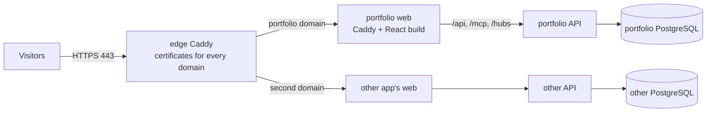

# Deploying to a Hostinger VPS

This guide puts the portfolio online on a Hostinger VPS, set up so the **same server can host more
sites** (for example a second app on its own domain). Every command is meant to be copied as it is.

- **Part A** prepares the server once.
- **Part B** puts the portfolio online.
- **Part C** adds another site later.
- **Part D** covers day-to-day management: a dashboard, updates and backups.

## How it fits together



- One small **edge Caddy** owns ports 80 and 443, gets a free Let's Encrypt certificate for every domain,
  and forwards each domain to its site over a private Docker network called `edge`.
- Each site runs in its own Docker Compose project. Only its web container joins `edge`; its API and
  database stay on the site's own private network, which no other site can reach.
- Nothing except the edge Caddy is reachable from the internet. No database port is ever published.

## Which plan, and do I need a control panel?

**Plan:** a **VPS (KVM)** plan. Shared, Web and Cloud hosting cannot run .NET or PostgreSQL.
For two .NET apps with two PostgreSQL databases, **KVM 2** (8 GB RAM) is comfortable. **KVM 1** (4 GB)
works if you add swap (step A5); building images on the server is the heaviest moment.

**Control panel:** you do not need one, and most do not fit this setup well.

| Option | Verdict |
|--------|---------|
| CloudPanel, Plesk, aaPanel, Webmin | Built for PHP and WordPress sites. They do not manage Docker apps well and add attack surface. Skip. |
| Coolify, Dokploy | Real Docker platforms with a nice UI, but they bring their own proxy (Traefik), use 1–2 GB RAM themselves, and expect one repository per app. These apps are built from two repositories, so they would need restructuring. Possible later, not needed now. |
| **Plain Docker Compose + Portainer** (recommended) | What this guide uses. Compose files are versioned in Git; **Portainer** gives a web dashboard to see containers, logs, CPU/RAM and restart things (step D1). It is opened through an SSH tunnel only, never public. |
| Hostinger hPanel | Keep using it for what it does best: snapshots, the browser terminal, firewall, OS reinstall and the VPS overview. |

## Security when several sites share one server

Publishing the code on GitHub is not the risk: no passwords or keys are in the repositories, and good
security never depends on hiding code. Sharing one server is a real risk you can keep small:

- **If one site is broken into**, the attacker is on the same machine as the others. The setup limits
  what they can reach:
  - Each site's API and database live on the site's own Docker network. Only web containers join
    `edge`, so one site cannot talk to another site's API or database.
  - Separate database users and passwords per site; no database port is published on the server.
  - Containers run as non-root users; the firewall allows only SSH, HTTP and HTTPS.
  - SSH with keys only (step A3); the Portainer dashboard is never exposed to the internet.
- **Rule of thumb:** a portfolio holds little that is sensitive. A school or business ERP holds
  personal data and payments. Sharing a server is fine while one app is small or in testing; once the
  ERP holds real customer data, give it **its own VPS**. Moving it is just Part C on a new server.
- Keep the server patched (A4), take snapshots and off-server backups (D3), and keep each site's
  `.env` readable only by you (`chmod 600 .env`).

---

## Part A. Prepare the server (once)

### A1. Pick the OS in hPanel

hPanel → **VPS** → your server → **OS & Panel** → **Operating System** → **Ubuntu 24.04** (plain).
Set a strong root password. Note the server's **IP address** from the VPS overview.

> Already installed plain Ubuntu? Keep it. Reinstalling wipes the server.

### A2. Connect

From Windows PowerShell (or hPanel → **Browser terminal**):

```bash
ssh root@YOUR_SERVER_IP
```

### A3. Create your own user and use SSH keys

Working as root all the time is risky. Create a user called `deploy`:

```bash
adduser deploy
usermod -aG sudo deploy
```

On **your Windows PC** (new PowerShell window), create a key if you do not have one, and copy it up:

```bash
ssh-keygen -t ed25519
type $env:USERPROFILE\.ssh\id_ed25519.pub | ssh root@YOUR_SERVER_IP "mkdir -p /home/deploy/.ssh && cat >> /home/deploy/.ssh/authorized_keys && chown -R deploy:deploy /home/deploy/.ssh && chmod 700 /home/deploy/.ssh && chmod 600 /home/deploy/.ssh/authorized_keys"
```

Check that this works **before** the next step: `ssh deploy@YOUR_SERVER_IP` must log in without a password.

Then turn off password and root logins (on the server):

```bash
sudo sed -i 's/^#\?PasswordAuthentication .*/PasswordAuthentication no/; s/^#\?PermitRootLogin .*/PermitRootLogin no/' /etc/ssh/sshd_config
sudo systemctl restart ssh
```

> If you ever lock yourself out, hPanel's **Browser terminal** still works.

### A4. Updates and firewall

```bash
sudo apt update && sudo apt -y upgrade
sudo apt -y install unattended-upgrades git
sudo dpkg-reconfigure -plow unattended-upgrades      # answer "Yes": security updates install themselves
sudo ufw allow OpenSSH && sudo ufw allow 80 && sudo ufw allow 443 && sudo ufw --force enable
sudo timedatectl set-timezone Asia/Dhaka
```

### A5. Swap (recommended on 4 GB plans)

```bash
sudo fallocate -l 2G /swapfile && sudo chmod 600 /swapfile && sudo mkswap /swapfile && sudo swapon /swapfile
echo '/swapfile none swap sw 0 0' | sudo tee -a /etc/fstab
```

### A6. Install Docker

```bash
curl -fsSL https://get.docker.com | sudo sh
sudo usermod -aG docker deploy
exit
```

Log in again (`ssh deploy@YOUR_SERVER_IP`) so the group change applies, then check: `docker version`.

> Docker publishes container ports past `ufw`. That is why only the edge Caddy publishes ports here.

### A7. Start the edge proxy

```bash
sudo mkdir -p /opt/edge /opt/apps && sudo chown deploy:deploy /opt/edge /opt/apps
docker network create edge
cd /opt/apps
git clone https://github.com/AshikurWebDev/Portfolio-API.git
git clone https://github.com/AshikurWebDev/Portfolio-Web.git
cp Portfolio-API/deploy/edge/docker-compose.yml Portfolio-API/deploy/edge/Caddyfile.example /opt/edge/
cd /opt/edge && cp Caddyfile.example Caddyfile && nano Caddyfile
```

In `Caddyfile`, put your email on the `email` line. The portfolio block already serves `ashikdev.tech`
and redirects `www.ashikdev.tech` to it; leave the second site commented out for now. Save with Ctrl+O, Enter, Ctrl+X. Do not start it yet:
the domain must point at the server first (B1).

---

## Part B. Put the portfolio online

### B1. Point the domain at the server

At the registrar of ashikdev.tech (hPanel → **Domains** → **DNS / Nameservers**, if it is at Hostinger):

| Type | Name | Points to |
|------|------|-----------|
| A | `@` | YOUR_SERVER_IP |
| A | `www` | YOUR_SERVER_IP |

Remove any other `A`/`AAAA` records for `@` and `www`. Wait until `ping ashikdev.tech` shows the server IP
(minutes to a few hours).

### B2. Allow Google sign-in on the live domain

Google Cloud Console → **APIs & Services** → **Credentials** → your OAuth client →
**Authorized JavaScript origins** → add `https://ashikdev.tech` (keep `http://localhost:5173`).

### B3. Fill in the settings

```bash
cd /opt/apps/Portfolio-API/deploy
cp .env.example .env && chmod 600 .env
nano .env
```

| Value | How to get it |
|-------|---------------|
| `WEB_DIR` | `../../Portfolio-Web` (already set) |
| `DOMAIN` | `ashikdev.tech`, no `https://` |
| `POSTGRES_PASSWORD` | run `openssl rand -base64 32` and paste the result |
| `JWT_SIGNING_KEY` | run `openssl rand -base64 48` and paste the result |
| `GOOGLE_CLIENT_ID` | the same id as `VITE_GOOGLE_CLIENT_ID` in your local `web/.env` |
| `ADMIN_EMAIL` | the Gmail address allowed into `/admin` |

### B4. Start the portfolio and the edge

```bash
cd /opt/apps/Portfolio-API/deploy
docker compose -f docker-compose.yml -f docker-compose.shared.yml up -d --build
cd /opt/edge && docker compose up -d
```

The first build takes a few minutes. The first API start creates the database tables, the Admin role,
the starter projects, three draft posts and the Skills section.

### B5. Check

```bash
curl https://ashikdev.tech/health           # {"status":"ok"}
docker compose -f /opt/edge/docker-compose.yml logs --tail 30    # certificate messages
```

Then open `https://ashikdev.tech/admin`, sign in with Google, upload your CV, and review the drafts.

---

## Part C. Add a second site (for example an ERP on its own domain)

The second app needs a **production Docker Compose file** that follows the same rules:

1. Its web container publishes **no ports** and serves plain HTTP on port 80 inside Docker.
2. That web container joins the external `edge` network with a unique alias, e.g. `educatory-web`.
3. Its API, database and workers stay on the app's own default network only.
4. Its own `.env` (with `chmod 600`) holds its own database passwords and keys.

Then:

1. Point the second domain's `A` records (`@`, `www`) at the same server IP.
2. Clone the app into `/opt/apps/<name>`, fill in its `.env`, and start it with `docker compose up -d --build`.
3. Uncomment its block in `/opt/edge/Caddyfile`, set the domain, and reload the edge without downtime:

   ```bash
   cd /opt/edge && docker compose exec caddy caddy reload --config /etc/caddy/Caddyfile
   ```

Caddy fetches the second certificate on its own. `docker-compose.shared.yml` in this folder is a working
example of rules 1–2.

---

## Part D. Manage, update, back up

### D1. Portainer dashboard (containers, logs, restarts)

```bash
docker volume create portainer_data
docker run -d --name portainer --restart=always -p 127.0.0.1:9443:9443 \
  -v /var/run/docker.sock:/var/run/docker.sock -v portainer_data:/data portainer/portainer-ce:lts
```

It listens only on the server itself. To open it, start a tunnel from your PC:

```bash
ssh -L 9443:localhost:9443 deploy@YOUR_SERVER_IP
```

Then browse to `https://localhost:9443` (accept the self-signed certificate) and create the admin
account within 5 minutes. Portainer controls Docker, which is root-level access: never publish its port.

### D2. Update the portfolio after a push to GitHub

```bash
cd /opt/apps/Portfolio-Web && git pull
cd /opt/apps/Portfolio-API && git pull
cd deploy && docker compose -f docker-compose.yml -f docker-compose.shared.yml up -d --build
```

`VITE_*` values are baked into the website when it is built: after changing `DOMAIN` or
`GOOGLE_CLIENT_ID`, run the same command (a restart alone is not enough).

### D3. Backups

The database holds posts, skills, the CV, design images and users. A nightly dump, kept 14 days:

```bash
mkdir -p ~/backups
crontab -e
```

Add this line (one line), save and exit:

```
30 2 * * * cd /opt/apps/Portfolio-API/deploy && docker compose -f docker-compose.yml -f docker-compose.shared.yml exec -T db pg_dump -U portfolio portfolio | gzip > ~/backups/portfolio-$(date +\%F).sql.gz && find ~/backups -name 'portfolio-*.sql.gz' -mtime +14 -delete
```

Copy backups off the server now and then (from your PC):

```bash
scp "deploy@YOUR_SERVER_IP:~/backups/*" .
```

Restore into a fresh stack: `gunzip -c file.sql.gz | docker compose ... exec -T db psql -U portfolio portfolio`.
Also turn on Hostinger's weekly backups and take a **snapshot** in hPanel before big changes.

### D4. When something goes wrong

| Symptom | Look at |
|---------|---------|
| Browser shows a certificate error | DNS not pointing at the server yet, or port 80/443 blocked: `docker compose -f /opt/edge/docker-compose.yml logs` |
| 502 Bad Gateway | The site is not running or not on `edge`: `docker ps`, then the site's `docker compose logs web` |
| Site loads but data is missing | `docker compose logs api` in the site's `deploy/` folder |
| Google sign-in fails | The domain is missing from the OAuth client's JavaScript origins (B2) |
| Server slow during builds | Add swap (A5) or build when traffic is low |

---

## Single-site setup (no edge proxy)

If this server will only ever host the portfolio, skip A7 and the shared file: the website container
can own ports 80/443 itself.

```bash
cd /opt/apps/Portfolio-API/deploy && docker compose up -d --build
```

## Files in this folder

| File | What it does |
|------|--------------|
| `docker-compose.yml` | PostgreSQL, the API and the website (from `WEB_DIR`, the Portfolio-Web repository) |
| `docker-compose.shared.yml` | Shared-server mode: no published ports, joins the `edge` network as `portfolio-web` |
| `.env.example` | Settings to copy into `.env` |
| `edge/docker-compose.yml`, `edge/Caddyfile.example` | The edge proxy for a multi-site server (copied to `/opt/edge`) |

## Tested

On 2026-11-16, locally with Docker: the edge Caddy in front of the portfolio in shared mode served every
page, the API, client-side routes and SignalR WebSockets; the portfolio published no host ports; and the
contact form's per-IP rate limit still applied when a client sent a fake `X-Forwarded-For` header
(5 accepted, then 429). Standalone mode was tested the same day with a fresh database (migrations and
seeding).
